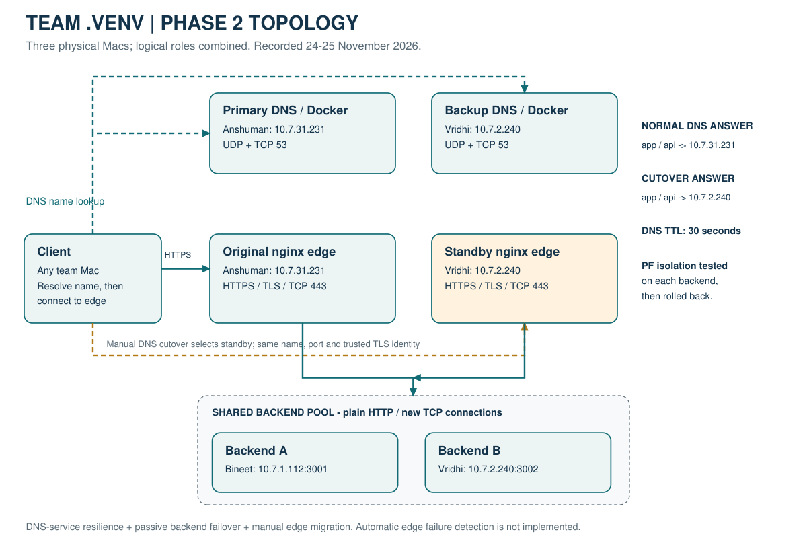

# Phase 2 architecture - Team .venv

Updated 25 November 2026. Read with the original Phase 1 architecture PDF.



Editable vector version: [phase2-topology.svg](diagrams/phase2-topology.svg).

| Physical Mac | LAN IP | Normal role | Temporary role |
|---|---|---|---|
| Anshuman | 10.7.31.231 | Primary Docker DNS, native nginx edge/TLS/load balancer | Test client |
| Bineet | 10.7.1.112 | Native Python Backend A :3001 | Test client; backend PF isolation |
| Vridhi (hostname Pranshus-MacBook-Pro) | 10.7.2.240 | Backup Docker DNS, native Python Backend B :3002 | Standby nginx :443; test client; backend PF isolation |

Rudraksh's absent DNS host is replaced by a container on an available Mac. The
two DNS services are on different physical hosts. Containers are not separate
LAN laptops: clients use the host LAN IP and published UDP/TCP port 53.

```text
                         +--> Primary DNS 10.7.31.231:53
Client -- name lookup ---|
                         +--> Backup DNS  10.7.2.240:53
                                   |
                    app/api -> original edge IP
                    (during migration -> standby IP)
                                   |
Client -- TCP + TLS + HTTPS :443 --> Anshuman nginx (normal)
                                   or Vridhi nginx (cutover)
                                   |
                         +---------+----------+
                         | plain HTTP        | plain HTTP
                         v                   v
                 A 10.7.1.112:3001    B 10.7.2.240:3002
```

DNS carries no application request and does not choose a backend. Each edge
terminates the client TLS/TCP connection, opens a separate backend TCP connection,
and supplies X-Forwarded-For. Both backends have stable shared cache content/ETag.

## Protocol/service inventory

| Flow | Protocol | Destination |
|---|---|---|
| Client to either resolver | DNS over UDP, TCP fallback | Host LAN IP :53 |
| Client to selected edge | HTTPS / TLS 1.2 or 1.3 / HTTP/2 or HTTP/1.1 | Edge :443 |
| Edge to A | Plain HTTP over TCP | 10.7.1.112:3001 |
| Edge to B | Plain HTTP over TCP | 10.7.2.240:3002 |

app.team1.test and api.team1.test normally map to 10.7.31.231 on both DNS servers.
Controlled migration maps them to 10.7.2.240, with TTL 30, and restores them afterward.
The separate ttl-demo.team1.test record supports an isolated caching experiment.

## Resilience, isolation and limitations

Primary/backup DNS tolerate a DNS-service outage. They do not fix an unavailable
application or edge. nginx uses passive backend detection, retries and a 10-second
failure window. The primary edge is a single point of failure in normal operation;
the standby was activated by manual DNS cutover, not an automatic health-based
edge failover system. Eliminating that limitation needs an additional detection
and traffic-steering mechanism supported by the LAN.

During separate isolation tests, PF on each backend allowed incoming IPv4 TCP to
its backend port from 10.7.31.231 and rejected other remote sources. Rules were
loaded into scoped project anchors via the existing com.apple/* parent, then
removed and enable references released. Both were rolled back before migration,
allowing the standby to reach A/B. If combined for evaluation, explicitly allow
the standby's source address during migration; do not assume the original
edge-only policy permits it.

Vridhi's unrelated supportdesk_nginx occupied :80/:443. The team stopped only that
container for standby preparation, then stopped standalone nginx and restored
Supportdesk after DNS rollback. The DNS container and Python backend stayed separate.

The existing trusted server identity covered app/api on either edge. A password-
protected PKCS#12 transfer provisioned standby locally. Private keys and decrypted
PEM files are not part of the repository or submission bundle.

Current evidence: ../04-Evidence/Phase2/EVIDENCE-INDEX.md. Full results and
learning summaries: ../05-Phase2-Final-Report/REPORT.md. A fresh three-Mac LAN
inventory and pairwise ping should be collected on the evaluation network if
DHCP/network conditions change; the original four-Mac inventory remains historical.
